<p align="center">
  <picture>
    <source media="(prefers-color-scheme: dark)" srcset="docs/assets/archi-made-easy-banner-dark.svg">
    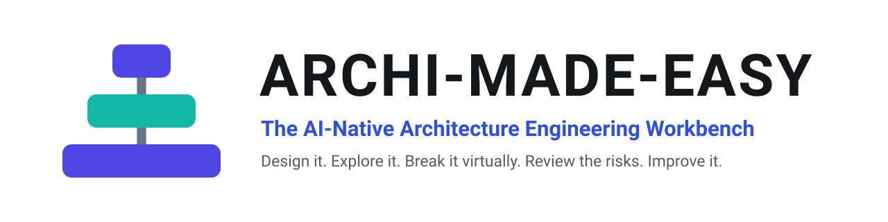
  </picture>
</p>

<h1 align="center">Archi-Made-Easy</h1>

<p align="center"><strong>The AI-Native Architecture Engineering Workbench</strong></p>

<p align="center"><strong>From one prompt to an interactive architecture.</strong><br>Design it. Explore it. Break it virtually. Review the risks. Improve it.</p>

<p align="center"><a href="https://avinashp7509.github.io/archi-made-easy/demo/">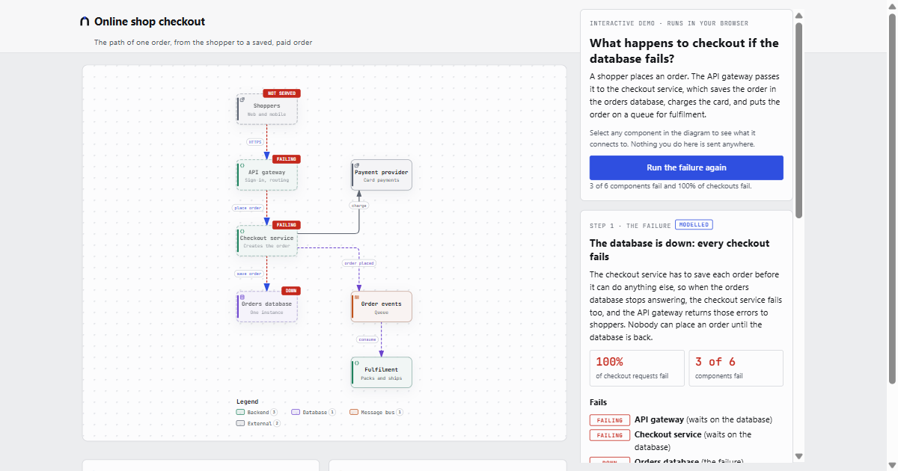</a><br><a href="https://avinashp7509.github.io/archi-made-easy/demo/"><strong>▶ Try the interactive demo</strong></a>: take down a checkout's database, see what fails, compare a standby. In your browser, no install.</p>

<p align="center"><sub>AI-native: your AI coding agent turns plain language into the architecture and runs the tools. The analysis itself (validation, review, simulation, capacity and cost) is a deterministic, tested model, so the same design always gives the same figures.</sub></p>

<p align="center">
  
  <a href="LICENSE"></a>
  <a href="https://github.com/Avinashp7509/archi-made-easy/releases"></a>
  <a href="https://github.com/Avinashp7509/archi-made-easy/actions/workflows/ci.yml"></a>
  <a href="docs/program/acceptance/agent-runs/README.md"></a>
  <a href="archi-made-easy/references/installation.md#compatibility-matrix"></a>
</p>

**Archi-Made-Easy is an Agent Skill for AI coding agents.** Describe a system in plain words. Your agent writes the architecture, checks it, and gives you one offline HTML page. In that page you can explore the design, review its risks, break it virtually, and read the modelled impact and recovery options, and the modelled cost once the document carries prices. You never write JSON, schemas or commands.

Current stable version: `v1.0.0` · Apache-2.0 · Node.js 18 or newer · no runtime npm dependencies

Using Microsoft 365 Copilot or a locked-down corporate laptop? See the [Microsoft Copilot Edition](#microsoft-copilot-edition--enterprise--restricted-environments): one ZIP to upload in Agent Builder, nothing to install.

<p align="center">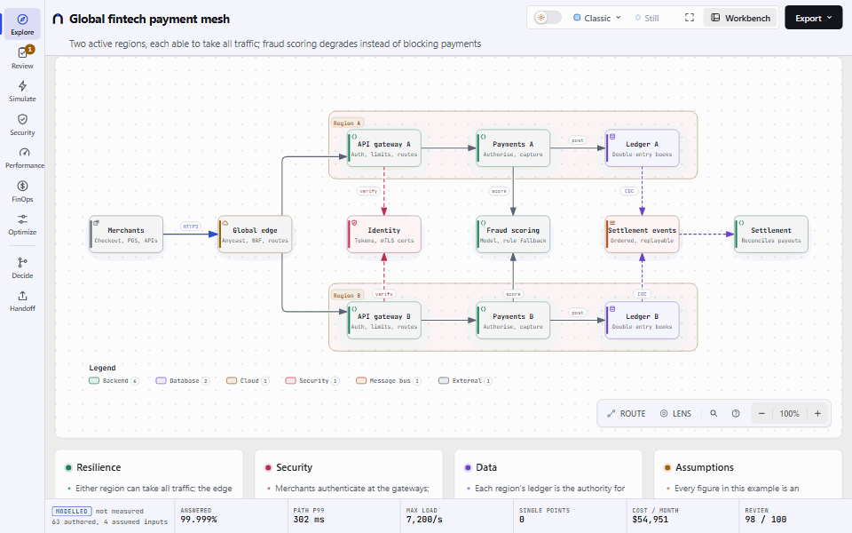</p>

<p align="center"><sub>Every frame is a screenshot of the running example pages in <a href="archi-made-easy/examples/">archi-made-easy/examples/</a>, taken by <a href="scripts/capture-demo-gif.mjs">scripts/capture-demo-gif.mjs</a>. Workbench figures are modelled, not measured.</sub></p>

```bash
npx skills add Avinashp7509/archi-made-easy
```

Then open a new agent session and ask, for example, *"Build a highly available e-commerce architecture on Azure."* The Skills CLI itself needs Node.js 22.20 or newer. The bundled installer (Node.js 18 or newer) and the supported agents are in the [Quick start](#quick-start).

<p align="center">
  <a href="#the-problem">Why</a> ·
  <a href="#what-you-can-do">Features</a> ·
  <a href="#quick-start">Quick start</a> ·
  <a href="#prompt-gallery">Prompts</a> ·
  <a href="#flagship-examples">Examples</a> ·
  <a href="#evidence-and-limitations">Evidence</a> ·
  <a href="#how-it-works">How it works</a> ·
  <a href="#community">Community</a>
</p>

## The problem

Architecture work is spread across tools that do not talk to each other. The diagram sits in a drawing tool and goes stale. Capacity and cost live in spreadsheets, and the review checklist lives in a wiki and is applied by hand. Questions such as *"what happens if the database fails?"* or *"what does ten times the traffic do?"* are answered from memory, or they wait for a test environment that does not exist yet. Turning a requirements document or an existing repository into an accurate diagram is manual work too. None of these pieces checks the others.

## The solution

One request gives you one file.

1. **You ask your agent** in your own words: *"Build a highly available e-commerce architecture on Azure."*
2. **The agent writes the architecture document.** When one of nine reference patterns is close, it starts from that pattern with the provider's service names filled in. The skill tells the agent to ask at most three questions, each with a default, and only when an answer would change the design. Everything else it assumes and writes down.
3. **The skill checks the document.** `finalize` validates it against its schema, renders the page and runs nine artifact checks on the diagram. It also runs a real-browser layout check in both themes, which needs Chrome, Chromium or Edge; without one, that gate is reported as skipped and `finalize` does not pass. When a gate fails, the skill names the repair.
4. **You get one HTML file.** It opens offline in a browser (tested in Chrome). The skill tells the agent to list its assumptions on the page and in its reply.
5. **You work with it.** Inspect components, review the risks, break the design virtually and compare options. Hand it off as Mermaid, draw.io, Structurizr or a design document. Follow-up questions such as "what if we lose a region?" are answered by running the same model, not by guessing.

<table>
<tr>
<td width="50%">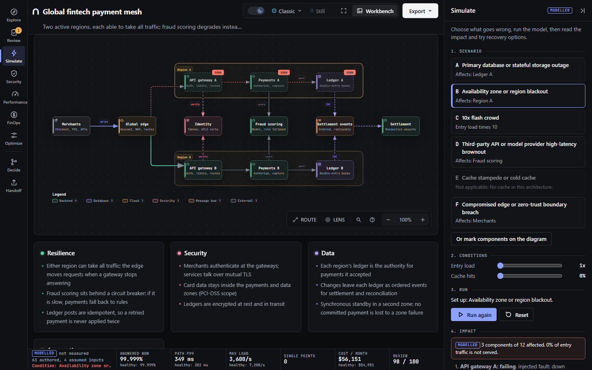<br><sub>Simulate: region A lost. Three of twelve components fail, the edge fails over to region B, and the vitals bar shows each figure beside its healthy value.</sub></td>
<td width="50%">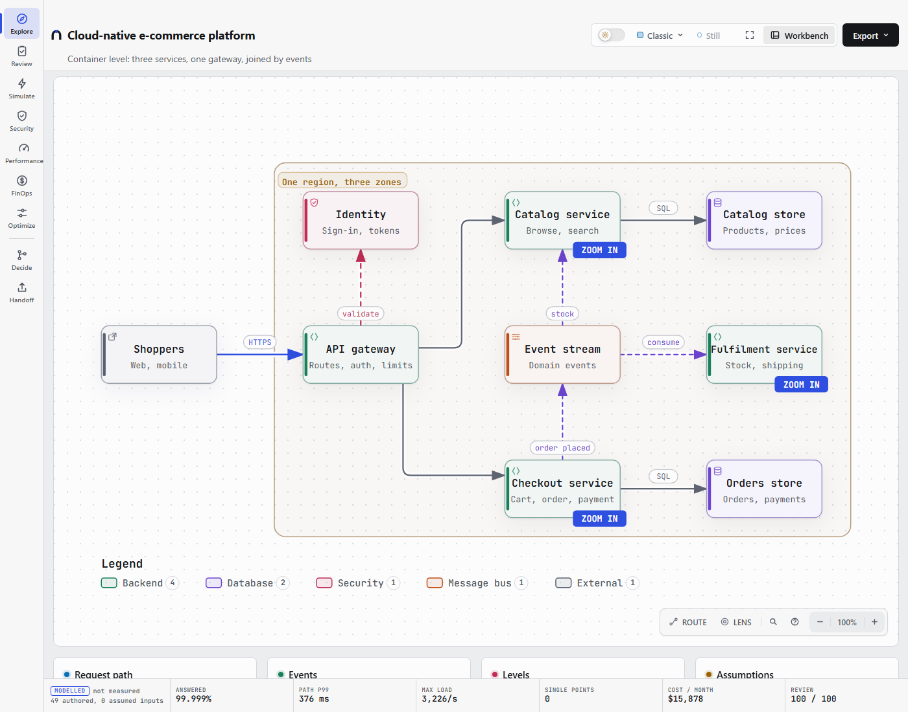<br><sub>A C4 container diagram. Each service with a ZOOM IN marker opens into its own component diagram, inside the same file.</sub></td>
</tr>
</table>

### The workbench

Architecture pages carry a workbench: nine modes around the diagram, an inspector, and a vitals bar with six modelled figures (answered requests, path P99, max load, single points of failure, cost per month, review score).

| Mode | Answers |
|---|---|
| Explore | What is this component, what does it depend on, which inputs are stated and which are assumed? |
| Review | What is wrong with this design, why it matters, what to change, and what the figures would be after the change |
| Simulate | What happens when something fails: set up a scenario, run it, watch it spread, compare before and after, try recovery options |
| Security | What is exposed, what each entry point reaches, and what protects it |
| Performance | Where it saturates under more load or a colder cache, and how slow it gets |
| FinOps | What it costs each month, by component, and how much of that is known |
| Optimize | Which changes improve the review most, previewed together |
| Decide | Decision records, alternatives compared, request traces stepped through on the diagram |
| Handoff | Mermaid, draw.io, Structurizr and design-document downloads |

**Honest figures.** Availability, latency, capacity and cost come from a deterministic analytical model of the design as declared. Every figure is tagged MODELLED and every input AUTHORED or ASSUMED, and the page states that it contains no measurements. The model ranks risks and shows how failures spread. It does not replace load tests, failover drills or a provider's own figures.

## What you can do

Every capability below ships in 1.0.0. Each entry says how to ask for it, what the agent runs, and where the evidence is. Commands are shown as `archi-made-easy <command>`; the agent runs them as `node bin/archi-made-easy.mjs <command>` from the installed skill folder. Four capabilities are marked **partly verified**, and their entries say what was checked and what was not.

### Create

**Architecture from a plain-language description**<br>
The agent starts from a reference pattern when one is close, writes the architecture document, checks it, and returns one page. The skill tells it to list its assumptions on the page and in its reply, to ask at most three questions, each with a default, and never to ask you for JSON, a schema or a command.
- **Ask:** "Build a highly available e-commerce architecture on Azure."
- **Runs:** `scaffold web-ha --provider azure --out candidate.json`, then `finalize architecture candidate.json shop.html --quality showcase`
- **Evidence:** agent runs [1](docs/program/acceptance/agent-runs/run-1.json), [2](docs/program/acceptance/agent-runs/run-2.json) and [3](docs/program/acceptance/agent-runs/run-3.json) passed. None of them asked for JSON, a schema or a command, none invented a figure, and each listed its assumptions on the page and in its reply ([summary](docs/program/acceptance/agent-runs/README.md#what-the-passing-runs-show)). Also [`test/workbench-scaffold.test.mjs`](test/workbench-scaffold.test.mjs).
- **Note:** exercised with Claude Code only. Every recorded run was a single turn, so asking questions has not been exercised. The skill checks the document and the page, not whether the design is sound. That depends on the agent and on your own review.

**Architecture from a code repository** · *partly verified*<br>
The agent reads entry points, configuration and call sites, and cites file paths and line ranges for components and relationships. With `--repo-root`, the skill checks every citation against the pinned Git revision and turns it into a source link in the page. Links are generated for GitHub, Gitee and GitLab; other origins stay local-only.
- **Ask:** "Convert my application repository into an interactive architecture diagram."
- **Runs:** `finalize architecture candidate.json repo.html --repo-root <repo> --quality showcase`
- **Verified:** agent [run 8](docs/program/acceptance/agent-runs/run-8.json) passed (12 components with file-and-line evidence). [`test/repository-evidence.test.mjs`](test/repository-evidence.test.mjs) checks the revision verification and that it fails closed. A [public proof](docs/cases/mco-runtime.architecture.html) diagrams an open-source repository with 13 source references pinned to one commit ([`test/real-repository-proof.test.mjs`](test/real-repository-proof.test.mjs)).
- **Not verified:** the run-8 fixture was not a Git checkout, so no real agent has exercised the revision check. Eight pinned-evidence tests are among the known Windows-only failures. Rebuilding the public proof from its pinned commit needs a clone of that repository: the test was skipped in the release run and last ran during the identity migration ([checklist](docs/program/CHECKLIST.md), Phase 1). There is no static code analyser: the agent reads the code, and the skill verifies what it cites.

**Architecture from a requirements document** · *partly verified*<br>
The agent extracts the scope, actors, integrations and non-functional requirements, and maps each requirement to a component, boundary, label or card. It records stated targets (availability, P99 latency, peak load, recovery, budget) so that five review rules check the design against them. Requirements it could not represent are listed in its reply.
- **Ask:** "Create an architecture from my uploaded requirements document."
- **Verified:** one Markdown [fixture](test/fixtures/acceptance/requirements-document/requirements.md), with Claude Code. Two attempts passed and one did not finish: [9b](docs/program/acceptance/agent-runs/run-9b.json) took 32 minutes (23 components), and [9c](docs/program/acceptance/agent-runs/run-9c.json), on the final archive, took 51 minutes (22 components). [9a](docs/program/acceptance/agent-runs/run-9a.json) was stopped by the 30-minute harness limit.
- **Not verified:** PDF or DOCX input. The skill has no document parser (the agent reads the file), and requirement coverage is reported by the agent, not checked by code.
- **Note:** stated targets apply to the whole design. The P99 target is compared with the modelled critical path, whatever journey the requirement names, and the budget is checked in US dollars only, because cost fields are in USD. Both requirements-document runs reported these limits: in 9b the critical path ran through a sign-up check that the 800 ms target did not cover, and in 9c a EUR budget could not be checked.

**Nine reference patterns on four providers**<br>
Each pattern is written as provider-neutral slots, and knowledge packs for Azure, AWS, GCP and on-premises fill those slots with real service names. All 36 pattern-and-provider combinations validate at showcase quality. The patterns are highly available web, multi-region active-active, microservices, event-driven, data platform, zero trust, AI agent platform, hybrid and migration landing zone.
- **Ask:** "Design a multi-region AWS architecture for 10 million users."
- **Runs:** `scaffold --list`, then `scaffold multi-region-active-active --provider aws --out candidate.json`
- **Evidence:** [`test/workbench-scaffold.test.mjs`](test/workbench-scaffold.test.mjs), the [provider examples](archi-made-easy/examples/providers/), and agent [run 3](docs/program/acceptance/agent-runs/run-3.json)
- **Note:** the packs name services only. They carry no SLA, price or quota figures. Each scaffold uses one provider; a design across two clouds has to be written by the agent.

**Eleven document types**<br>
Architecture, workflow, sequence, data flow, lifecycle (state), ERD, tree, class, timeline and waterfall. There is also a one-page explainer that leads with its conclusion. It can embed up to four native diagrams and Mermaid-syntax charts (pie, bar and line, quadrant, sankey, radar, venn), rendered to static SVG. `guide` recommends a type for a scenario.
- **Ask:** "Draw the checkout request as a sequence diagram." · "Show the order states." · "Make it a one-pager."
- **Runs:** `finalize <type> candidate.json out.html --quality showcase`
- **Evidence:** [`test/core-smoke.test.mjs`](test/core-smoke.test.mjs) validates, renders and delivers every type's example; [`test/golden.mjs`](test/golden.mjs) checks that every bundled page equals a fresh render.
- **Note:** the workbench, review, simulation, exports and comparison apply to architecture documents only. If you paste Mermaid, the agent re-authors it; it is not converted mechanically. The explainer's browser tests are opt-in and were not run for 1.0.0; its structure and delivery checks were.

<details>
<summary><strong>One of each diagram type</strong> (screenshots of the bundled example pages)</summary>
<br>
<table>
<tr>
<td width="50%">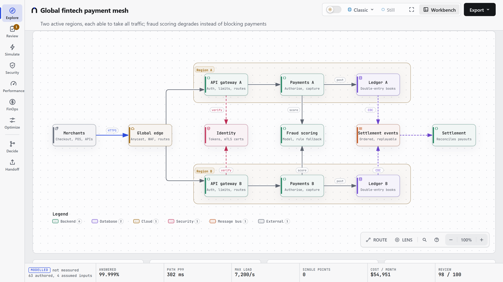<br><sub>Architecture</sub></td>
<td width="50%">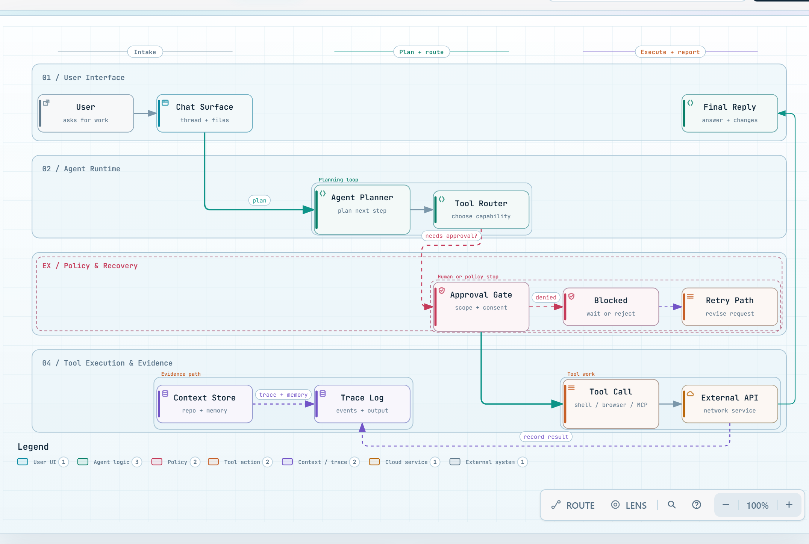<br><sub>Workflow</sub></td>
</tr>
<tr>
<td>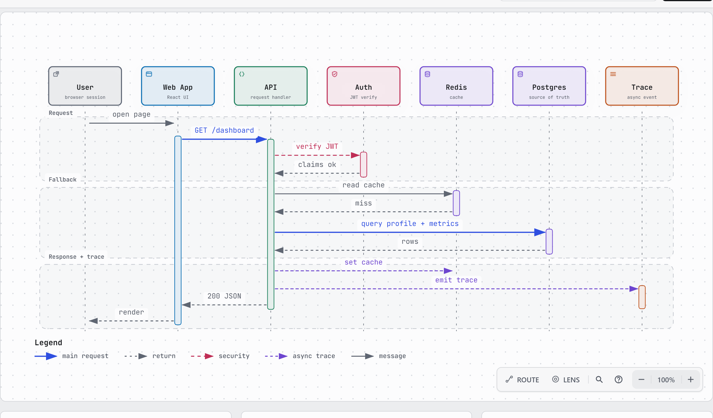<br><sub>Sequence</sub></td>
<td>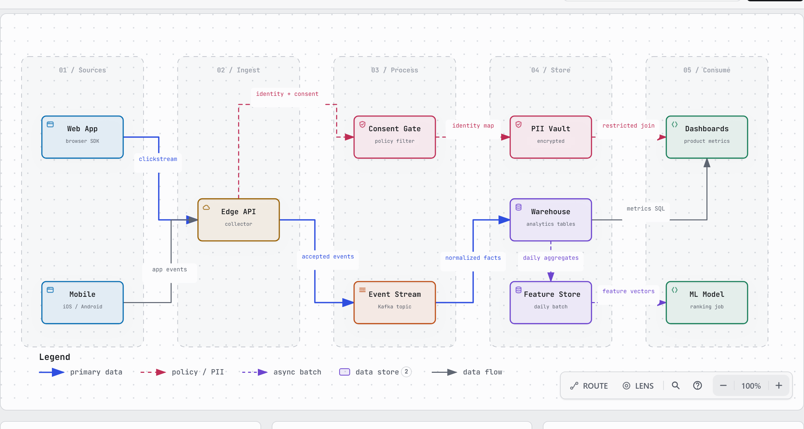<br><sub>Data flow</sub></td>
</tr>
<tr>
<td>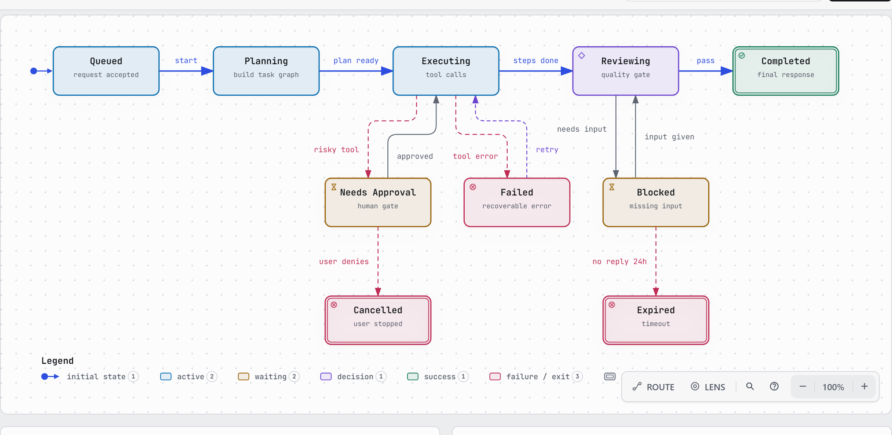<br><sub>Lifecycle</sub></td>
<td>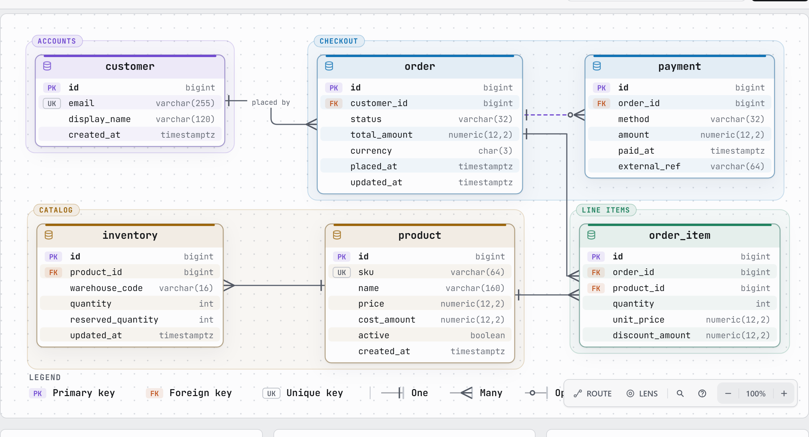<br><sub>ERD</sub></td>
</tr>
<tr>
<td>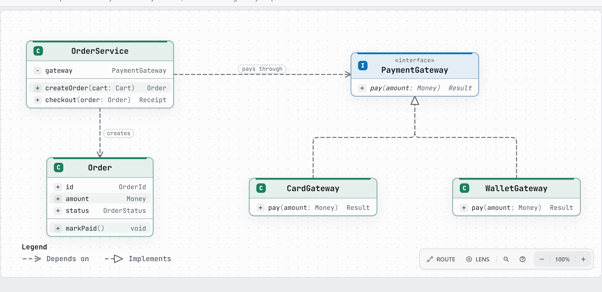<br><sub>Class</sub></td>
<td>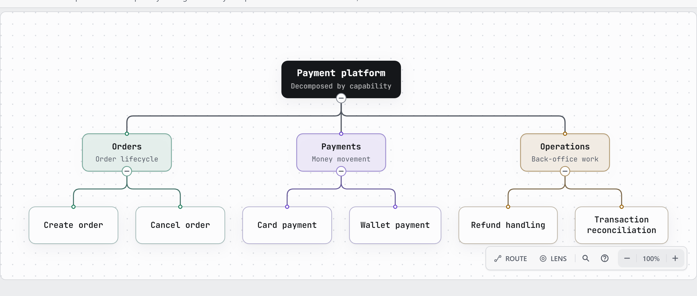<br><sub>Tree</sub></td>
</tr>
<tr>
<td>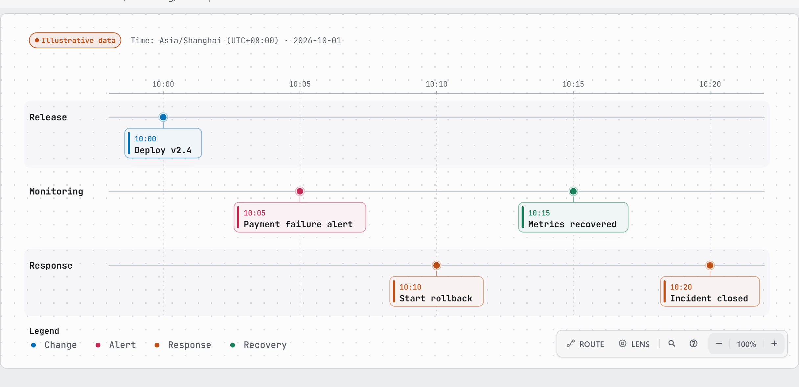<br><sub>Timeline</sub></td>
<td>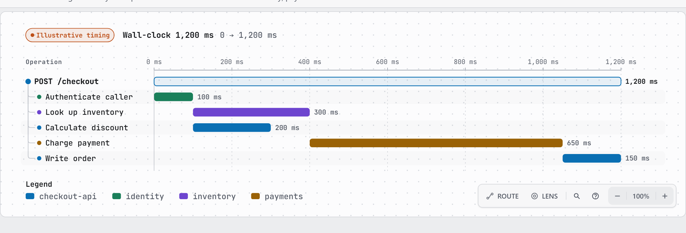<br><sub>Waterfall</sub></td>
</tr>
</table>
</details>

### Explore

**One interactive page**<br>
Each document renders to one standalone HTML page holding a single SVG diagram. The page has zoom and pan, light and dark themes, style presets, a presentation stage, Live or Still motion and an export menu. Architecture pages add the workbench.
- **Evidence:** [`test/workbench-browser.test.mjs`](test/workbench-browser.test.mjs), and the [visual QA record](docs/visual-qa/FINAL-VISUAL-ACCEPTANCE.md): 744 interface states with 0 critical and 0 high defects
- **Note:** on phones and tablets, the smallest labels render under 6px until you zoom (D-016). Architecture pages are about 1.1 to 1.4 MB.

**Component inspection**<br>
You can search components by name or id, select one to see its facts and neighbours, filter by kind, follow guided views, use the minimap and copy deep links. In Explore, each component's role, redundancy, availability, capacity and latency are shown tagged AUTHORED or ASSUMED (or "not stated"). Its recovery time and point are tagged AUTHORED when stated, and its security settings are shown as declared. All of this sits next to its modelled load and cost ([screenshot](#global-fintech-payment-mesh)).
- **Ask:** "Explain this architecture." · "What does the API gateway depend on?"
- **Evidence:** [`test/workbench-browser.test.mjs`](test/workbench-browser.test.mjs), [`test/focus-browser.test.mjs`](test/focus-browser.test.mjs), [`test/finder-browser.test.mjs`](test/finder-browser.test.mjs)
- **Note:** inspection is read-only. Nothing you change in the page is saved back to the document.

**Dependency tracing**<br>
You can light up everything upstream or downstream of a component, and find the shortest directed path between two components and step through it. Hovering previews one hop, and Decide steps through the request traces written in the document. Route and Reach Share Cards save the result as a 1200 × 630 image.
- **Ask:** "What does checkout depend on?" · "Show the path from users to the ledger."
- **Evidence:** [`test/focus-browser.test.mjs`](test/focus-browser.test.mjs), [`test/route-probe-browser.test.mjs`](test/route-probe-browser.test.mjs)
- **Note:** tracing follows the relationships written in the document, not runtime calls. Reach is not failure impact; Simulate answers that question.

<p align="center">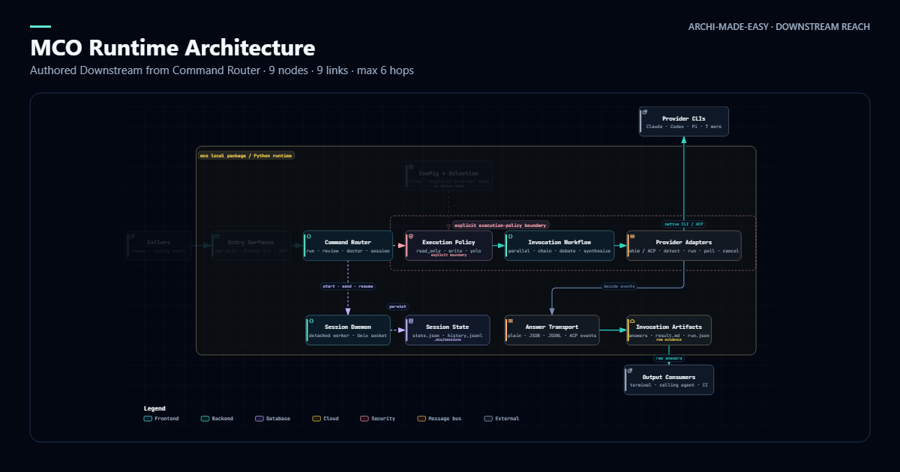<br><sub>A Reach Share Card exported by the viewer: everything downstream of one component in the <a href="docs/cases/mco-runtime.architecture.html">public repository proof</a>.</sub></p>

**C4 drill-down**<br>
A component can open into a complete child architecture diagram one level down, carried inside the same HTML file; for example, a C4 container opens into its components. The level opens in a sandboxed frame under a Back bar, and it has its own workbench, figures, review and scenarios.
- **Ask:** "Show the platform at C4 container level and let me open each service."
- **Evidence:** [`test/workbench-levels.test.mjs`](test/workbench-levels.test.mjs), and the [e-commerce example](#cloud-native-e-commerce-with-c4-levels)
- **Note:** a document holds at most four child diagrams, nested at most three levels. Children are authored like any other document; they are not generated automatically. `review`, `simulate` and `export` cover the document they are given, so to analyse a child on the command line, save it as its own file. Verified on one flagship example.

### Analyse

**Architecture review and scorecard**<br>
The review checks 14 rules across six pillars: reliability, security, performance, cost, operational excellence and sustainability. Each finding gives its evidence, its consequence and a recommended change. Where the change is an operational setting, the page can also preview the fix. The score is 100 minus the finding weights (critical 15, high 8, medium 4, low 1). Findings that rest on assumed values count half. Each pillar gets its own score.
- **Ask:** "Review this solution architecture and identify risks."
- **Runs:** `review arch.json`. `review --strict`, and `validate` or `finalize` with `--arb strict`, exit non-zero on a critical finding.
- **Evidence:** [`test/workbench-review.test.mjs`](test/workbench-review.test.mjs) checks that each rule fires on a failing fixture and stays quiet on a passing one. Also agent [run 4](docs/program/acceptance/agent-runs/run-4.json).
- **Note:** only [these 14 rules](archi-made-easy/references/arb-well-architected-rules.md) are checked. Network design, IAM policies, data classification, secrets, observability and backup testing are not. The rules follow the Well-Architected frameworks and NIST SP 800-207 by topic only. The score is not a certification or a statement of compliance.

**Failure and chaos scenarios**<br>
Six preset scenarios: (A) database outage, (B) zone or region blackout, (C) 10x flash crowd, (D) provider brownout, (E) cache stampede and (F) edge breach. You can also set any component, connection or boundary to degraded, brownout, down, partitioned or surge. The result shows how the failure spreads through blocking calls, fallbacks, circuit breakers and disaster-recovery failover. It then offers recovery options, and the page previews each one under the same failure.
- **Ask:** "What happens if the database fails?" · "What if we lose a region?"
- **Runs:** `simulate arch.json --scenario a` (or `all`), or `simulate arch.json --fault db=down`
- **Evidence:** [`test/workbench-sim.test.mjs`](test/workbench-sim.test.mjs), [`test/workbench-analysis.test.mjs`](test/workbench-analysis.test.mjs) (every scenario runs on every pattern), [`test/workbench-remedy.test.mjs`](test/workbench-remedy.test.mjs), and agent [run 5b](docs/program/acceptance/agent-runs/run-5b.json)
- **Note:** this is a deterministic analytical model, not chaos engineering: nothing is injected into a running system. Failures are treated as independent. Scenario F lists what can be reached without authentication; it does not simulate an attack. Recovery previews are not saved to the document.

<p align="center">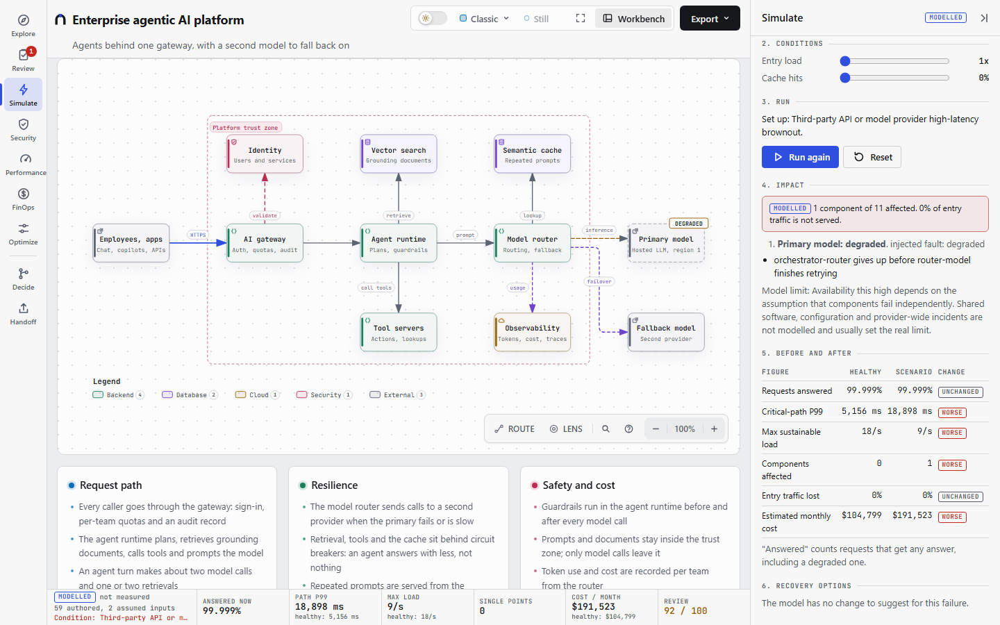<br><sub>Scenario D on the agentic AI example: the primary model slows down. The router keeps retrying it, because the analytical model moves calls to the fallback only when the primary fails (down or cut off), not when it is slow, and the agent runtime's timeout gives up first. Critical-path P99 goes from 5,156 to 18,898 ms (modelled).</sub></p>

<p align="center">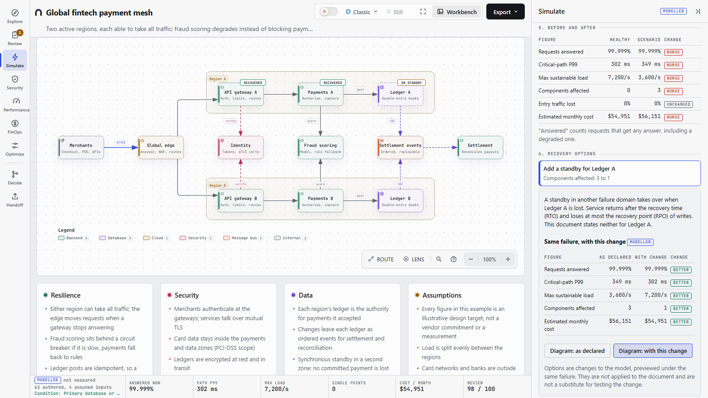<br><sub>Scenario A on the fintech example: Ledger A is down, and the option "Add a standby for Ledger A" is previewed. Components affected drop from 3 to 1 (modelled). The option's note that the document states no recovery time or point for Ledger A is a known text defect (<a href="docs/visual-qa/DEFECT-REGISTER.md">D-036</a>): the document states RPO 0 and RTO 60 s.</sub></p>

**Traffic and capacity**<br>
Scale the entry traffic and the cache hit ratio. The model then reports per-component load and utilisation, saturation, the maximum sustainable load and the component that limits it, and headroom. It also reports retry amplification, retry storms, and queue lag behind slow consumers.
- **Ask:** "Simulate a 20x increase in traffic." · "How much load can it take?"
- **Runs:** `simulate arch.json --multiplier 20 --cache-hit 0.8`. In the page, Performance has live sliders for load (1x to 50x) and cache hits.
- **Evidence:** [`test/workbench-sim.test.mjs`](test/workbench-sim.test.mjs), and agent [run 6b](docs/program/acceptance/agent-runs/run-6b.json)
- **Note:** load figures need a baseline load written on an entry component. Without one, only capacity limits are reported; loads are never invented. The model is steady-state, with no autoscaling delay. Missing capacities use role defaults, tagged ASSUMED.

**Availability and latency**<br>
The model computes the composite availability of the request path from each component's availability and redundancy, taking fallbacks and circuit breakers into account. For latency, it fits each hop to a lognormal distribution, sums the hops (Fenton-Wilkinson) and reads the critical-path P50, P95 and P99 from the fit, instead of adding percentiles.
- **Ask:** "How available is this design?" · "What is the P99 of checkout?"
- **Runs:** `simulate arch.json --json`
- **Evidence:** [`test/workbench-sim.test.mjs`](test/workbench-sim.test.mjs), [`test/workbench-model.test.mjs`](test/workbench-model.test.mjs)
- **Note:** correlated failures are not modelled, so figures above 99.99% carry a note saying so. Missing values are planning defaults per role, not provider SLAs.

**Security and trust boundaries**<br>
For each entry point, Security lists what it reaches without passing an authenticated component, and which trust zones it reaches. It shows the declared sign-in and encryption of each component. The review raises zero-trust-violation (critical) and unencrypted-data-store findings.
- **Ask:** "What is exposed?" · "What if the edge is compromised?"
- **Runs:** `simulate arch.json --scenario f` and `review arch.json`
- **Evidence:** [`test/workbench-analysis.test.mjs`](test/workbench-analysis.test.mjs) ("breach reach stops at authenticated components"), [`test/workbench-review.test.mjs`](test/workbench-review.test.mjs)
- **Note:** this is structural reachability over declared relationships. It is not a threat model, not a penetration test, and not an IAM, network-policy or secrets analysis. A "not stated" in the page is not evidence that a control is missing.

**FinOps and cost**<br>
FinOps estimates a 730-hour month from prices written in the document. It counts base cost per instance, scaled by the instances the load needs, plus cost per million requests, storage, and egress on connections that cross a region or zone boundary. The cost is reported per component, together with its coverage (how many components carry prices) and the cost findings.
- **Ask:** "What does this cost?" · "Optimize this architecture for lower cost."
- **Runs:** `simulate arch.json --cost`, then `review`. The agent edits the document and runs both again to show before and after.
- **Evidence:** [`test/workbench-analysis.test.mjs`](test/workbench-analysis.test.mjs). In agent [run 7](docs/program/acceptance/agent-runs/run-7.json), the modelled cost of the 4 of 10 components that carry prices went from $1,108.48 to $498.92 a month. The agent set the new tiers and prices itself, as illustrative targets, and named the trade-offs.
- **Note:** nothing is priced unless the document carries a price. There is no price catalogue, and the provider packs hold no prices. This is a model, not a bill or a quote.

**Failure-mode table (FMEA)**<br>
The table has one row per component, made by failing that component alone in the model. Each row gives the local effect, the affected and failing components, the share of entry traffic lost and a severity class. It also gives recovery data (RTO, RPO, failover, writes at risk), the existing controls and the recommended actions. The same table is section 6 of the design-document export.
- **Ask:** "Give me a failure-mode table." · "What is the blast radius of each component?"
- **Runs:** `simulate arch.json --fmea`
- **Evidence:** [`test/workbench-analysis.test.mjs`](test/workbench-analysis.test.mjs), [`test/workbench-export.test.mjs`](test/workbench-export.test.mjs)
- **Note:** the table has one failure mode per component and no occurrence or detection ratings, so no risk priority number; those need operating history. The table is produced by the command line and in the design document. The page shows the impact of each scenario instead.

### Decide and hand off

**Decisions, alternatives and ranked improvements**<br>
The document can hold decision records (context, decision, options with pros and cons, consequences). It can also hold named alternatives that override operational fields, and each one is compared with the authored design on the same measures. Optimize ranks the fixes the page can preview by how much each raises the review score, and previews them together.
- **Ask:** "Compare a zone-redundant database option." · "Why is it built this way?"
- **Runs:** `review arch.json --alternatives`
- **Evidence:** [`test/workbench-compare.test.mjs`](test/workbench-compare.test.mjs), [`test/workbench-remedy.test.mjs`](test/workbench-remedy.test.mjs)
- **Note:** an alternative changes operational fields such as redundancy and resilience, never the structure. Decision records are authored text: the tool shows and exports them, but it does not make decisions.

**Compare two designs**<br>
`review --against` compares two designs on six modelled measures: availability, critical-path P99, max sustainable load, single points of failure, monthly cost and review score. It also lists the findings closed and opened, and the components added and removed. `compare architecture` writes a visual before, delta and after page, plus a JSON receipt that classifies each authored change.
- **Ask:** "What changed between these two designs?" · "Is option B better than A?"
- **Runs:** `review after.json --against before.json`, or `compare architecture base.json head.json delta.html --receipt delta.json`
- **Evidence:** [`test/workbench-compare.test.mjs`](test/workbench-compare.test.mjs), [`test/architecture-delta.test.mjs`](test/architecture-delta.test.mjs), and the example [checkout delta page](examples/checkout-platform-delta.html)
- **Note:** `compare architecture` covers the authored diagram (components, connections, boundaries, presentation), not operational figures. Components are matched by exact id, so a renamed id counts as one removal plus one addition.

**Exports** · *partly verified*<br>
The command line exports an architecture as standalone HTML, Markdown with Mermaid (a flowchart, a C4 diagram, and one sequence per authored trace, or for the request path when none is authored), draw.io with the declared positions kept, a Structurizr DSL workspace, or a Markdown design document with modelled figures labelled. The page's Export menu gives SVG (auto, light, dark), PNG (download or copy), JPEG, WebP, a 6-second WebM, and Route and Reach Share Cards. Workbench › Handoff downloads the four text formats, produced by the same exporter code as the command line.
- **Ask:** "Give me this as draw.io." · "Mermaid for our README." · "A design document for the review board."
- **Runs:** `export <html|mermaid|drawio|structurizr|rfc> arch.json <output>`
- **Verified:** the structure and escaping of every format ([`test/workbench-export.test.mjs`](test/workbench-export.test.mjs), [`test/workbench-security.test.mjs`](test/workbench-security.test.mjs)). The page and the command line produce byte-identical exports ([`test/workbench-engine-parity.test.mjs`](test/workbench-engine-parity.test.mjs)). [29 of 29 Mermaid diagrams](docs/program/acceptance/mermaid-parse-2026-11-10.md) were parsed and rendered by Mermaid 11.4.1.
- **Not verified:** the draw.io and Structurizr files were not opened in diagrams.net or Structurizr. The Mermaid parser check predates the latest escaping changes (S-03, S-12). There is no command-line SVG or PNG export: images come from the page.

### Trust

**One offline, portable file**<br>
The diagram, the viewer, an embedded font, the workbench engine, the document's data and any C4 child pages are all inline. The page opens from disk with no network and no server, and its figures equal what the command line prints for the same inputs.
- **Ask:** "Give me something I can open offline or send to a colleague."
- **Evidence:** [`test/offline-self-containment.test.mjs`](test/offline-self-containment.test.mjs). In the [clean install](docs/program/acceptance/clean-install-2026-11-11-release.json), seven pages were opened in Chrome with the network switched off, and their figures equalled `simulate --json`.
- **Note:** the command line contacts the network only for the update check, for `brands capture <url>` and for the re-check of a pinned brand mark. `ARCHI_MADE_EASY_UPDATE_CHECK_DISABLED=1` and `ARCHI_MADE_EASY_BRAND_CAPTURE_DISABLED=1` turn them off. Changes made in the page are not saved into the file.

**Validation and quality gates**<br>
Every document is validated against its JSON schema (12 schemas), with cross-reference checks. `finalize` then runs four gates and stops at the first failure:
1. validate;
2. deliver, an atomic render;
3. check, nine artifact checks: single SVG, finite geometry, orthogonal arrows, label and route clearance, crossings, corridors, container borders, route rhythm and legend clearance;
4. browser-check, a real-browser layout check in both themes.

A failure returns structured diagnostics with suggested fixes.
- **Runs:** automatically on every create request, as `finalize <type> candidate.json out.html --quality showcase --json`
- **Evidence:** [`test/finalize.test.mjs`](test/finalize.test.mjs), [`test/finalize-browser.test.mjs`](test/finalize-browser.test.mjs), [`test/render-output-checks.test.mjs`](test/render-output-checks.test.mjs)
- **Note:** these are automated checks, not a review by eye. Without Chrome, Chromium or Edge, the browser gate reports "skipped" and `finalize` exits 2 instead of passing.

**Reproducible figures and evidence** · *partly verified*<br>
The engine has no randomness, clock or I/O, so the same document and inputs always give the same figures. The page's copy of the engine is generated from the same modules and tested equal to them. The flagship figures are recorded as a regression benchmark, every bundled example must equal a fresh render, and the release archive rebuilds byte for byte.
- **Ask:** "Can I trust and rerun these numbers?"
- **Runs:** `simulate arch.json --scenario all --json`, which gives identical output on every run
- **Verified:** [`test/workbench-engine-parity.test.mjs`](test/workbench-engine-parity.test.mjs), [`test/workbench-benchmark.test.mjs`](test/workbench-benchmark.test.mjs), [`test/golden.mjs`](test/golden.mjs), and the [release acceptance report](docs/program/RELEASE-ACCEPTANCE.md#2-regression-suites-final-tree), sections 2 and 8
- **Not verified:** everything ran on Windows 11 with Node 24. The Linux and macOS CI jobs have not run on this repository yet. Raw suite logs stay on the release machine, and only summaries are committed. "Deterministic" means repeatable; it does not mean the figures predict production.

## Quick start

### Requirements

| Need | Required? | Used for |
|---|---|---|
| Node.js 18 or newer | Required | Every command. The skill has no npm dependencies at runtime. The release evidence is from Node.js 24; Node.js 18 and 20 run in CI after the first push. |
| An agent that can run shell commands | Required | The agent runs `node` commands. Allow `node` for the project if your client asks for approval. |
| Chrome, Chromium or Edge | Optional, but without one `finalize` reports the browser gate as skipped (exit 2) instead of passing | The real-browser layout gate in `finalize`. Images are exported from the page itself (tested in Chrome). |

### Install with the Skills CLI

```bash
npx skills add Avinashp7509/archi-made-easy
```

This installs the `archi-made-easy` skill from this repository with the [Skills CLI](https://github.com/vercel-labs/skills). The Skills CLI itself needs Node.js 22.20 or newer, and `npx` fetches its current release. The release was tested with the bundled installer below. The Skills CLI path is covered by a test that runs Skills CLI 1.7.0 against a local copy of this repository and the release archive, for Codex with `--copy --yes` ([`test/skill-installation.test.mjs`](test/skill-installation.test.mjs)). Installing from GitHub with the Skills CLI, its default interactive flow and discovery on skills.sh had not been verified at release, because the repository was not yet public.

### Install from the release archive or a clone

Download `archi-made-easy.zip` from the GitHub Release and unpack it with any zip tool. Then, from the folder that contains `archi-made-easy/`, run:

```bash
node archi-made-easy/install.mjs --agent claude-code
```

The archive's SHA-256 is `ca480ef81f1c65751538b0ac69fa0fea01c774153a7a22995b577d4bb4b162ef` (6,951,339 bytes, 257 entries).

From a clone, the installer copies the same files that a release ships:

```bash
git clone https://github.com/Avinashp7509/archi-made-easy.git
cd archi-made-easy
node archi-made-easy/install.mjs --agent claude-code   # or codex, github-copilot, cursor, opencode, windsurf, gemini-cli
```

More installer options, each a separate command:

| Command | Does |
|---|---|
| `node archi-made-easy/install.mjs --agent claude-code --project .` | Installs for this project only |
| `node archi-made-easy/install.mjs --dest /path/to/skills-folder` | Installs into the skills folder of any other Agent Skills client; replace the path with that folder |
| `node archi-made-easy/install.mjs --list` | Lists the agents and their folders |
| `node archi-made-easy/install.mjs --agent claude-code --dry-run` | Shows the plan and writes nothing |

### What happens on install

- The skill is copied into the agent's skill folder, either globally or for one project.
- `doctor` runs from the installed copy and checks every renderer, schema and runtime.
- The installer never modifies a folder it did not create. It replaces its own install only with `--replace`, and it never follows or copies symbolic links.
- Afterwards, restart the agent or open a new session so that it discovers the skill.

### Supported agents

| Agent | Installer id | Evidence |
|---|---|---|
| Claude Code | `claude-code` | **Exercised.** Nine plain-language prompts in 13 recorded runs with Claude Code 2.1.219 on Windows 11, 12 of them on release candidates and one on the final archive ([records](docs/program/acceptance/agent-runs/README.md)) |
| OpenAI Codex | `codex` | **Install placement verified** |
| GitHub Copilot | `github-copilot` | **Install placement verified** |
| Cursor | `cursor` | **Install placement verified** |
| OpenCode | `opencode` | **Install placement verified** |
| Windsurf | `windsurf` | **Install placement verified** |
| Gemini CLI | `gemini-cli` | **Install placement verified** |
| Other Agent Skills clients | `--dest <folder>` | Documented only |

"Install placement verified" means that automated tests install the skill into the agent's documented folder in a clean temporary home, and that `doctor` passes from the installed copy. Whether the agent discovers that folder is taken from the Skills CLI registry, not observed. These agents have not been exercised in use. Folders and details are in the [compatibility matrix](archi-made-easy/references/installation.md#compatibility-matrix).

### Update and uninstall

To update an install made by this installer, run it from the newer release:

```bash
node archi-made-easy/install.mjs --agent claude-code --replace
```

To remove it:

```bash
node archi-made-easy/install.mjs --agent claude-code --uninstall
```

`deliver` and `finalize` check this project's release manifest at most once a day, and only tell you when a newer release exists; they never download or install anything. The manifest is served from the project's GitHub Pages, which is not live for 1.0.0, so for now the check finds nothing. Set `ARCHI_MADE_EASY_UPDATE_CHECK_DISABLED=1` to turn it off. Troubleshooting: [installation guide](archi-made-easy/references/installation.md#troubleshooting).

<details>
<summary><strong>A recorded clean install from the release archive</strong></summary>
<br>
<p align="center">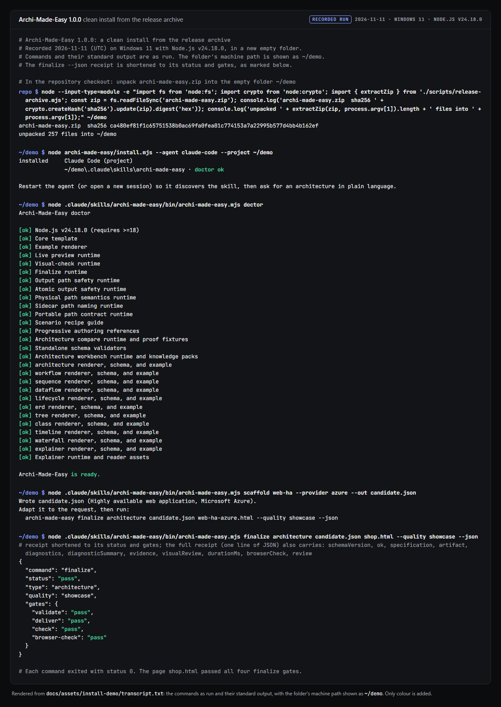</p>

<sub>Recorded on 2026-11-11 on Windows 11 with Node.js 24.18.0, in a new empty folder. The image renders <a href="docs/assets/install-demo/transcript.txt">transcript.txt</a>: the commands as run and their standard output, with the folder path shown as <code>~/demo</code> and the <code>finalize</code> receipt shortened to its status and gates. Every command exited 0. The image is not a product screenshot and was not made by the capture script: a one-off page, not kept in the repository, rendered the transcript. Besides colour, it adds a title bar and wraps long lines, although its footer mentions only colour.</sub>

</details>

## Microsoft Copilot Edition — Enterprise & Restricted Environments

For Microsoft 365 Copilot Agent Builder and other locked-down environments where people cannot install Node.js, npm or Git. It is the same engine, repackaged as one ZIP that meets Agent Builder's skill rules. The Full Edition above is unchanged.

<p><a href="archi-made-easy-copilot.zip"><strong>⬇ Download Microsoft Copilot Skill (.zip)</strong></a> · <a href="editions/copilot/README.md">Edition guide</a> · <a href="editions/copilot/README.md#validation-report">Validation report</a></p>

| | Full Edition | Microsoft Copilot Edition |
|---|---|---|
| For | Coding agents on your computer (Claude Code, Codex, Cursor and others) | Microsoft 365 Copilot Agent Builder (upload under **Skills**) |
| You install | Node.js 18+ and the skill | Nothing |
| Engine: validation, review, failure, load and cost simulation | Yes | Yes, the same files. Pages are byte-identical (tested). |
| Interactive HTML workbench page | Yes | Yes, when the platform returns files |
| Mermaid, draw.io, Structurizr, RFC exports; all ten diagram types | Yes | Yes |
| Real-browser layout check, one-page explainers, web brand logos | Yes | No (no browser or network in the sandbox) |
| Without Node.js | Not supported | Labelled fallback: Mermaid, architecture JSON, rule-based review, failure reasoning. Not computed by the engine. |

**Add it to an agent:**

1. Download the ZIP and check its SHA-256.
2. In Microsoft 365 Copilot, go to **Agents** → **New agent** → **Configure** → **Skills** → **Add skill**, and upload the ZIP without unpacking it.
3. Add an instruction such as "Use the archi-made-easy skill for every architecture question", test it in the preview, then publish.

You need a Microsoft 365 Copilot licence (or pay-as-you-go), and your administrator must allow skills. Full steps: [install in Agent Builder](editions/copilot/README.md#install-in-agent-builder).

**Try:**

- "Design a highly available e-commerce platform on Azure."
- "What happens if the primary database fails?"
- "We expect twenty times the traffic on Black Friday. What breaks first?"
- "Export this as Mermaid for our wiki."

| Package | Value |
|---|---|
| ZIP size | 1,731,067 bytes (1.7 MB; limit 50 MB) |
| Files | 213 (limit 350 per agent) |
| Deepest folder | 2 levels (limit 3) |
| `SKILL.md` | At the root, 11,496 characters (limit 20,000) |
| SHA-256 | `95ed9aad76280c00c8b6a91e5d34739268d614f4f170926ed7d174678a3df4fc` |
| Sandbox validation | **UNVERIFIED.** Tested locally from the unpacked ZIP with the network blocked. Not yet run inside Microsoft's sandbox, which does not document whether it provides Node.js. |

Figures are modelled from the declared design, not measured, in both editions.

## Prompt gallery

Copy any of these into your agent. Eight were given word for word to Claude Code with the skill freshly installed from a release candidate, and the run records hold the commands, tokens, cost and the agent's final reply. The other two are examples that have not been run. The candidates' guidance differs from 1.0.0 (see [all 13 agent runs](#what-was-tested)).

| # | Topic | Prompt | Record |
|---|---|---|---|
| 1 | Azure e-commerce | `Build a highly available e-commerce architecture on Azure.` | Run word for word: [run 1](docs/program/acceptance/agent-runs/run-1.json), pass, 21 min |
| 2 | AWS multi-region | `Design a multi-region AWS architecture for 10 million users.` | Run word for word: [run 3](docs/program/acceptance/agent-runs/run-3.json), pass, 9 min |
| 3 | Enterprise banking | `Create a secure banking application architecture.` | Run word for word: [run 2](docs/program/acceptance/agent-runs/run-2.json), pass, 9 min |
| 4 | Agentic AI platform | `Design an enterprise agentic AI platform on Azure: agents behind one gateway, retrieval over our documents, tool servers and a fallback model provider.` | Example, not run. It starts from the `ai-agent-platform` pattern. |
| 5 | Kubernetes microservices | `Design a microservices platform on Google Kubernetes Engine with an API gateway, an event bus and a database per service.` | Example, not run. It starts from the `microservices` pattern on `gcp`. |
| 6 | Existing repository | `Convert my application repository into an interactive architecture diagram.` | Run word for word: [run 8](docs/program/acceptance/agent-runs/run-8.json), pass, 16 min |
| 7 | Failure simulation | `What happens if the database fails?` | Run word for word: [5a](docs/program/acceptance/agent-runs/run-5a.json) failed (the skill was not used; its description was widened), [5b](docs/program/acceptance/agent-runs/run-5b.json) passed in 77 s |
| 8 | Traffic surge | `Simulate a 20x increase in traffic.` | Run word for word: [6a](docs/program/acceptance/agent-runs/run-6a.json) failed (API stall), [6b](docs/program/acceptance/agent-runs/run-6b.json) passed in 72 s |
| 9 | Cost optimisation | `Optimize this architecture for lower cost.` | Run word for word: [run 7](docs/program/acceptance/agent-runs/run-7.json), pass, 6 min |
| 10 | Architecture review | `Review this solution architecture and identify risks.` | Run word for word: [run 4](docs/program/acceptance/agent-runs/run-4.json), pass, 99 s |

Prompts 7 to 10 ask about an architecture that already exists: in those runs, the project held an [architecture document](test/fixtures/acceptance/existing-architecture/solution.architecture.json). Prompt 6 ran in a small [application repository](test/fixtures/acceptance/application-repository/). The ninth acceptance prompt, `Create an architecture from my uploaded requirements document.`, is described under [Create](#create).

## Flagship examples

Three complete examples ship rendered, each with its source document beside it. Their figures are illustrative design targets written into the document, not vendor commitments or measurements, and everything the workbench computes from them is modelled. GitHub shows an HTML file as source code, so to open a page, clone the repository or download the file and open it in a browser.

### Global fintech payment mesh

<p align="center">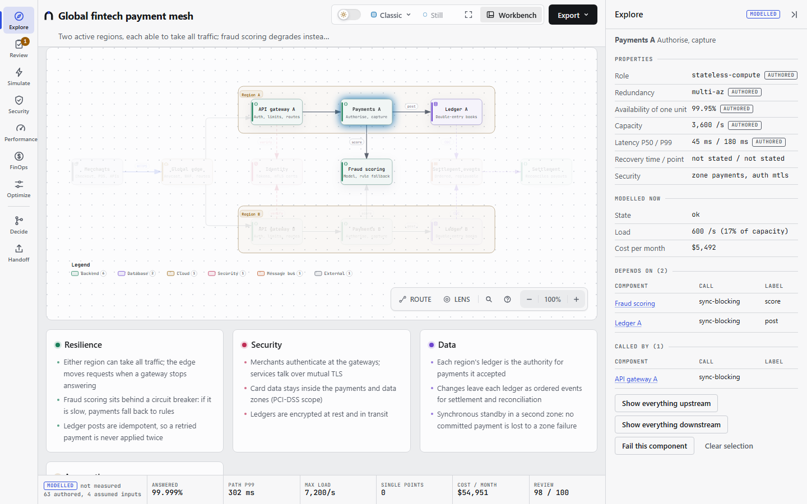<br><sub>Explore, with Payments A selected: its stated properties tagged AUTHORED (its recovery time and point are not stated), the modelled state and load, what it depends on and what calls it.</sub></p>

The mesh has two active regions behind a global edge, and each region can take all the traffic. Payments and a double-entry ledger run in each region, and settlement runs through ordered events. Fraud scoring sits behind a circuit breaker that falls back to rules. The design has 12 components, and its stated targets are 99.95% availability, 450 ms P99, 3,000 requests/s at peak, RPO 0, RTO 120 s and a $60,000 monthly budget.

- **Review:** score 98. One medium finding: a deep synchronous chain, which rests on assumed values.
- **Simulate:** scenarios A, B, C, D and F apply; E does not, because there is no cache. When region A goes dark, 3 of 12 components fail, the edge fails over to API gateway B, and no entry traffic is lost. When Ledger A is down, the option "Add a standby for Ledger A" cuts the components affected from 3 to 1. All of these figures are modelled.
- **FinOps:** $54,951 a month, modelled from the prices written in the example, with 11 of 12 components priced.
- **Decide:** two decision records, two request traces and one alternative.

[Page](archi-made-easy/examples/global-fintech-payment-mesh.html) · [Document](archi-made-easy/examples/global-fintech-payment-mesh.architecture.json)

### Enterprise agentic AI platform

<p align="center">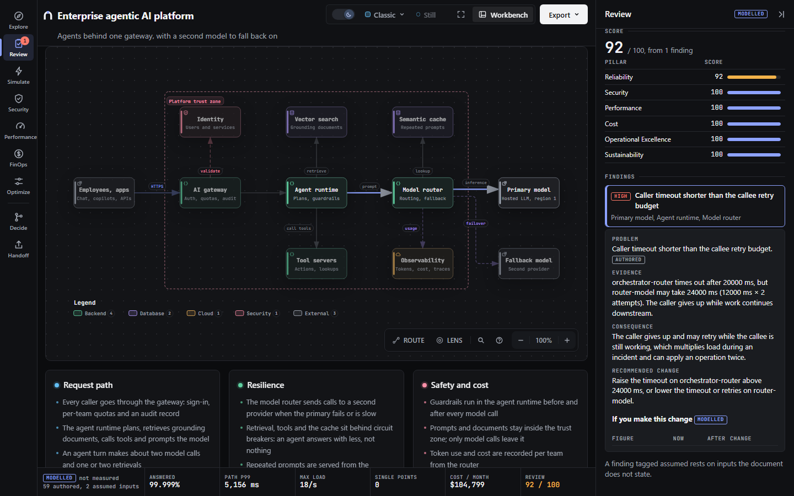<br><sub>Review, dark theme: score 92, and the one finding with its evidence, consequence and recommended change. The preview table under it is empty: the suggested timeout closes this finding but opens the same one a hop upstream, so no modelled figure changes, and the page does not yet say so (<a href="docs/visual-qa/DEFECT-REGISTER.md">D-037</a>).</sub></p>

On this platform, every caller goes through one AI gateway that handles sign-in, quotas and audit. Behind it, an agent runtime plans, retrieves grounding documents through vector search and calls tool servers. A model router sends prompts to a primary model and fails over to a second provider, and a semantic cache and observability sit beside the router. The design has 11 components, with GDPR, SOC 2 and EU data residency stated as requirements.

- **Review:** score 92. One high finding, which rests on authored values: the orchestrator-to-router timeout (20,000 ms) is shorter than the router-to-model retry budget (12,000 ms × 2 attempts).
- **Simulate:** scenarios A, C, D, E and F apply; B does not, because no boundary is marked as a region or zone. In scenario D, the primary model slows down and the router keeps retrying it: the fallback route carries traffic only when the primary fails (down or cut off), and the agent runtime's timeout gives up first. Critical-path P99 goes from 5,156 to 18,898 ms (modelled). The example's Resilience card says the router switches when the primary "fails or is slow"; the model covers only the first case.
- **FinOps:** $104,799 a month, modelled from the prices written in the example, with 10 of 11 components priced.
- **Decide:** two decision records, two request traces and one alternative.

[Page](archi-made-easy/examples/enterprise-agentic-ai-platform.html) · [Document](archi-made-easy/examples/enterprise-agentic-ai-platform.architecture.json)

### Cloud-native e-commerce with C4 levels

<p align="center">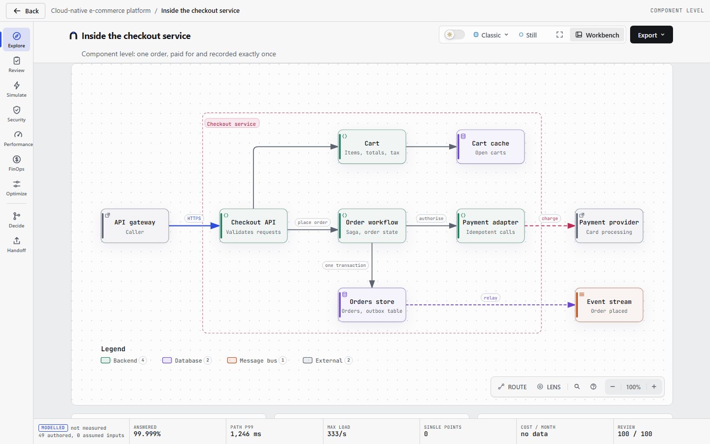<br><sub>One level down: the checkout service at component level, opened from the container diagram, with Back and the path above it.</sub></p>

This is a C4 container diagram in one region with three zones. Shoppers reach an API gateway in front of the catalog and checkout services. Checkout publishes orders to an event stream, which the fulfilment and catalog services consume. Each service opens into its own component diagram. All three child diagrams are carried in the same file, and each one has its own workbench. The container level has 9 components.

- **Review:** score 100, no findings.
- **Simulate:** scenarios A, B, C and F apply. D and E do not, because the design has no external provider and no cache.
- **FinOps:** $15,878 a month, modelled from the prices written in the example, with 8 of 9 components priced.
- **Levels:** open a service with its ZOOM IN marker, the Open button in Explore, or a double click.

[Page](archi-made-easy/examples/cloud-native-ecommerce-c4.html) · [Document](archi-made-easy/examples/cloud-native-ecommerce-c4.architecture.json)

The four provider starting points (Azure zero trust, AWS event-driven, GCP microservices, on-premises hybrid) are in [archi-made-easy/examples/providers/](archi-made-easy/examples/providers/). Each one is an unchanged `scaffold` of its pattern.

## Evidence and limitations

Everything below comes from the [release acceptance report](docs/program/RELEASE-ACCEPTANCE.md), which says what ran, where, on which revision, and what was not tested. It was all run on one machine: Windows 11, Node 24.18.0 and Chrome.

### What was tested

| Check | Result | Record |
|---|---|---|
| Full unit and integration suite | 3,580 tests: 3,338 pass, 198 skipped, 1 todo, 43 fail. The 43 failures are exactly the known Windows-only baseline (symlink permissions, path separators, `git init --template=`, 8.3 short names), with none new and none gone. The pass condition is "no failure outside that set". | [Report §2](docs/program/RELEASE-ACCEPTANCE.md#2-regression-suites-final-tree), [baseline](docs/program/BASELINE.md) |
| Real-browser suite, serial | 316 tests: 309 pass, 0 fail, 7 skipped (the opt-in explainer browser tests) | [Report §2](docs/program/RELEASE-ACCEPTANCE.md#2-regression-suites-final-tree) |
| Visual QA matrix | 744 interface states across 12 documents, six viewports and two themes: 0 critical, 0 high, 12 medium. All 12 medium findings are one inherited defect, D-016. 182 screenshots. | [Visual acceptance](docs/visual-qa/FINAL-VISUAL-ACCEPTANCE.md), [defect register](docs/visual-qa/DEFECT-REGISTER.md) |
| Golden examples | Every committed example page equals a fresh render | [Report §2](docs/program/RELEASE-ACCEPTANCE.md#2-regression-suites-final-tree) |
| Release archive | Rebuilt byte-identical. Checked for contents, licences, identity and the absence of machine paths. | [Report §8](docs/program/RELEASE-ACCEPTANCE.md#8-release-archive) |
| Clean install from the archive | 23 of 23 steps. The skill was installed for Claude Code and Codex and `doctor` passed. Seven showcase documents were finalized, reviewed, run through every preset scenario and exported. Each page was then opened offline, and its figures equalled the command line. | [Record](docs/program/acceptance/clean-install-2026-11-11-release.json) |
| Real-agent runs | 9 prompts and 13 runs, with 10 passes. Every prompt passed after at most one diagnosed rerun, and the total reported cost was $29.00. Twelve runs used release candidates A and B, whose guidance differs from 1.0.0 (A also had a narrower skill description); run 9c used the final archive. | [Agent runs](docs/program/acceptance/agent-runs/README.md) |
| Security review | Findings S-01 to S-12, below. `npm audit` reports 0 vulnerabilities for the root development dependencies and for the skill. The website toolchain, which is not released, has 7 open advisories (S-07). | [Security review](docs/program/SECURITY-REVIEW.md) |

<details>
<summary><strong>All 13 agent runs</strong> (Claude Code 2.1.219 with Claude Opus 5 at <code>xhigh</code> effort, shell limited to <code>node</code>, no web access, MCP servers or sub-agents)</summary>
<br>

| Run | Archive | Prompt | Outcome | Time | Cost (USD) |
|---|---|---|---|---|---|
| [1](docs/program/acceptance/agent-runs/run-1.json) | A | Build a highly available e-commerce architecture on Azure. | pass: page, 14 components, review 96 | 1,263 s | 3.48 |
| [2](docs/program/acceptance/agent-runs/run-2.json) | A | Create a secure banking application architecture. | pass: page, provider-neutral by stated assumption | 548 s | 2.32 |
| [3](docs/program/acceptance/agent-runs/run-3.json) | A | Design a multi-region AWS architecture for 10 million users. | pass: page | 541 s | 1.99 |
| [4](docs/program/acceptance/agent-runs/run-4.json) | A | Review this solution architecture and identify risks. | pass: answered from `review` and `simulate` | 99 s | 0.56 |
| [5a](docs/program/acceptance/agent-runs/run-5a.json) | A | What happens if the database fails? | fail: the skill was not used (its description did not cover analysis questions; fixed) | 61 s | 0.21 |
| [5b](docs/program/acceptance/agent-runs/run-5b.json) | B | What happens if the database fails? | pass: answered from `simulate` | 77 s | 0.53 |
| [6a](docs/program/acceptance/agent-runs/run-6a.json) | B | Simulate a 20x increase in traffic. | fail: API stall before the skill was reached | 572 s | 0.08 |
| [6b](docs/program/acceptance/agent-runs/run-6b.json) | B | Simulate a 20x increase in traffic. | pass: answered from `simulate` | 72 s | 0.53 |
| [7](docs/program/acceptance/agent-runs/run-7.json) | B | Optimize this architecture for lower cost. | pass: new page, modelled $1,108 to $499 a month (4 of 10 components priced) | 346 s | 1.80 |
| [8](docs/program/acceptance/agent-runs/run-8.json) | B | Convert my application repository into an interactive architecture diagram. | pass: page with file-and-line evidence | 949 s | 3.39 |
| [9a](docs/program/acceptance/agent-runs/run-9a.json) | B | Create an architecture from my uploaded requirements document. | fail: stopped by the 30-minute harness limit | 1,800 s | not reported |
| [9b](docs/program/acceptance/agent-runs/run-9b.json) | B | Create an architecture from my uploaded requirements document. | pass: page, 23 components | 1,925 s | 6.25 |
| [9c](docs/program/acceptance/agent-runs/run-9c.json) | 1.0.0 | Create an architecture from my uploaded requirements document. | pass on the final 1.0.0 archive: page, 22 components | 3,085 s | 7.87 |

Archive: A and B are release candidates. Their guidance in `references/` differs from 1.0.0, the final archive carries fixes made after them, and A also had a narrower skill description ([what differs](docs/program/RELEASE-ACCEPTANCE.md#8-release-archive)). Claude Code also used Claude Haiku 4.5 for its own small tasks. The runs before 9c that record their models used the 1M-context variant of Claude Opus 5 (9a records none).

Each page passes the nine artifact checks and the real-browser layout gate when re-checked on its own. The records are curated: the raw event streams are not published, because they carry account session and request identifiers. Almost all of the time in the create runs is the model reasoning before its first draft; each `finalize` took 4 to 7 seconds ([why the create runs take so long](docs/program/acceptance/agent-runs/README.md#why-the-create-runs-take-so-long)).

</details>

### Security review

This review was done by the implementing agent, reading the code and attacking it with tests. It is not an independent audit, and no certification is claimed. Authored text is treated as untrusted: it stays text in the page, in child diagrams and in every export. A child diagram runs in a sandboxed frame without same-origin access, and a rendered page makes no network request of its own.

| ID | Severity | Finding | Status |
|---|---|---|---|
| S-01 | high, release blocker | draw.io export: authored markup became live HTML in draw.io labels | Fixed, regression tests |
| S-02 | medium | Design-document export inserted authored text into Markdown unescaped | Fixed, tests |
| S-03 | medium | Mermaid export: authored text could end a statement or a code fence | Fixed, tests |
| S-04 | low | The page script spelled a closing body tag | Fixed, guard test |
| S-05 | info | No Content Security Policy in a single offline page with only inline code | Accepted, documented |
| S-06 | low | A development dependency had advisories (not in the archive) | Fixed |
| S-07 | medium, website only | The inherited website toolchain has 7 advisories. The website is not part of this release. | Open |
| S-08 | medium | A pinned brand mark in someone else's document made the command line contact the host it names | Fixed: `ARCHI_MADE_EASY_BRAND_CAPTURE_DISABLED=1`, tested |
| S-09 | low | `export --force` wrote through a directory or a link | Fixed, tested |
| S-10 | low | A level marker could also name the page's JSON data blocks (no path from authored text) | Accepted for 1.0.0, scheduled |
| S-11 | info | Brand requests announced an inherited version number | Fixed, tested |
| S-12 | high | Text exports: line breaks, backslashes, substitutions and directives in authored text could add lines or directives | Fixed, tests; not verified inside Structurizr or Mermaid |

### Limitations

- **Figures are modelled.** They come from an analytical model of the design as declared. They are not measurements, load tests or provider commitments. Failures are treated as independent, and missing values use labelled role defaults.
- **Design quality depends on the agent.** The skill checks the document and the page, and the review checks 14 rules; neither proves that a design is right.
- **One agent exercised.** Only Claude Code was exercised, on Windows 11, at `xhigh` effort. Twelve of its 13 runs used release candidates whose guidance differs from 1.0.0 (one of them also had a narrower skill description); one run used the final archive. Every run was a single turn, so clarifying questions were not exercised. The six other agents are verified for install placement only.
- **Linux and macOS only through CI.** The CI workflows for Linux and macOS exist but have not yet run on this repository.
- **Node.js 24 only.** The release tests ran on Node.js 24 (the archive is built with Node.js 22). Node.js 18 and 20 have not been run; CI runs them after the first push.
- **Skills CLI from GitHub not yet verified.** The Skills CLI path was tested with Skills CLI 1.7.0 from a local copy only. It needs Node.js 22.20 or newer.
- **Browsers.** The page, its exports and offline use were tested in Chrome on Windows 11 only. Firefox, Safari and Edge were not tested, and WebM export needs a browser that can record WebM.
- **Stated targets are checked against the whole design.** The P99 target is compared with the modelled critical path, whatever journey the requirement names, and the budget is checked in US dollars only.
- **Large create requests are slow.** Create requests took about 9 to 51 minutes. The requirements-document request took 32 and 51 minutes, and once did not finish within 30. Almost all of that time is model reasoning before the first draft; the skill's commands take seconds. Review, failure and load questions about an existing design took 1 to 2 minutes, and the cost optimisation, which wrote a new page, took 6. Lower effort settings were not measured.
- **Small labels on phones and tablets.** The smallest diagram labels render at 4.4 to 6.0px until you zoom ([D-016](docs/visual-qa/DEFECT-REGISTER.md)).
- **English-only workbench.** The workbench text is English only. The rest of the viewer has six locale catalogs, which were not reviewed by native speakers.
- **Exports not opened in their tools.** The draw.io and Structurizr exports were checked by parsing, not by opening them in diagrams.net or Structurizr. The Mermaid check predates the latest escaping changes. There is no command-line image export.
- **Partly verified inputs.** Repository evidence and requirements documents are partly verified, as described under [Create](#create).
- **Page changes are not saved.** Changes made in the page, such as previews, faults and options, are not saved back into the document.
- **No website or update notices yet.** The website and the update notices are not live, because GitHub Pages is off for 1.0.0. S-07 and S-10 remain, as listed above.

## How it works

### The skill package

```text
archi-made-easy/          what the installer copies into the agent's skill folder
  SKILL.md                read by the agent first: plain-language rules and the delivery steps
  references/             task guides read on demand: intents, review rules, simulation, cost, exports, installation
  schemas/                12 JSON schemas: 11 document types and the shared definitions
  knowledge/              26 provider-neutral slots, 9 reference patterns, 4 provider packs
  workbench/              the deterministic engine
  renderers/              one renderer per document type, plus shared code
  bin/                    the command line
  assets/template.html    the page template, generated from viewer/
  examples/               bundled documents and the pages rendered from them
  install.mjs             the installer
viewer/                   page sources: viewer, camera, focus, route probe, export, workbench
```

Start with [SKILL.md](archi-made-easy/SKILL.md) and the [intents guide](archi-made-easy/references/intents.md). They set out how a plain-language request becomes a document, which questions the agent may ask, and how analysis questions are answered by the model.

### The deterministic core

[`archi-made-easy/workbench/`](archi-made-easy/workbench/) is plain JavaScript with no randomness, clock or I/O.

| Module | Does |
|---|---|
| `model.mjs` | Builds the model from the document: roles, boundaries, trust zones, alternatives, and default values tagged as assumed |
| `defaults.mjs` | Planning defaults for 13 operational roles (availability, capacity, latency, redundancy); not provider SLAs |
| `sim.mjs` | Fault propagation, traffic, saturation, retries, failover, composite availability, critical-path latency |
| `scenarios.mjs` | The six preset scenarios, and breach reach for scenario F |
| `review.mjs` | The 14 rules, six pillars, weights and scores |
| `fmea.mjs` | The failure-mode table |
| `cost.mjs` | Monthly cost from authored prices, with coverage |
| `remedy.mjs` | Recovery options and previewed fixes |
| `compare.mjs` | Design snapshots and modelled comparisons |
| `levels.mjs` | Packs and restores C4 child diagrams |
| `scaffold.mjs` | Turns a pattern and a provider pack into a starting document |
| `exporters/` | Mermaid, draw.io, Structurizr and the design document |

The benchmark test holds the model, review, failure table and six recovery plans within a 1.5-second budget per flagship ([`test/workbench-benchmark.test.mjs`](test/workbench-benchmark.test.mjs)). The modules are documented in [capacity, latency and FinOps](archi-made-easy/references/capacity-latency-and-finops.md), [chaos and failure simulation](archi-made-easy/references/chaos-and-failure-simulation.md) and [exports, comparison and the workbench](archi-made-easy/references/workbench-ui-and-exporters.md).

### The page

- Each result is one HTML file. The viewer sources in [`viewer/`](viewer/) are compiled into the template by [`scripts/generate-viewer.mjs`](scripts/generate-viewer.mjs).
- The page runs its own copy of the engine, [`viewer/workbench-engine.js`](viewer/workbench-engine.js), generated from the same modules by [`scripts/generate-workbench-engine.mjs`](scripts/generate-workbench-engine.mjs). A parity test holds the model, simulation, scenarios, failure modes, cost, review, previews and exports identical in the page and on the command line.
- The workbench builds every element with `createElement` and `textContent`. It has no `innerHTML`, and a test fails if one appears.
- The page makes no network request. Child diagrams open in a sandboxed frame without same-origin access.

### Command line

<details>
<summary><strong>All 21 commands</strong> (run as <code>node bin/archi-made-easy.mjs &lt;command&gt;</code>; <code>help</code> or <code>&lt;command&gt; --help</code> prints the full usage)</summary>
<br>

| Command | What it does |
|---|---|
| `finalize <type> <input.json> <output.html>` | The agent's one-shot delivery: validate, deliver, strict check and real-browser check, with a compact receipt; `--arb warn` or `--arb strict` adds a review block |
| `validate <type> <input.json>` | Checks the schema, workbench references and layout without writing a page |
| `render <type> <input.json> [output.html]` | Renders a standalone page without the delivery gates |
| `deliver <type> <input.json> [output.html]` | Validates, renders atomically and runs the artifact checks, then writes a delivery receipt |
| `preview <type> <input.json> [output.html]` | Serves a live local preview on the loopback address that re-renders when the input changes |
| `check <output.html>` | Runs the nine artifact checks on a rendered page |
| `browser-check <output.html>` | Real-browser layout check in Chrome, Chromium or Edge |
| `visual-check <output.html>` | Browser check plus screenshot captures for a review by eye |
| `inspect architecture <input.json>` | Prints the measured layout of an architecture document |
| `scaffold <pattern> --provider <id>` | Writes a starting architecture document; `scaffold --list` lists the 9 patterns and 4 providers |
| `review <architecture.json>` | Rule-based review with score and findings; `--against <earlier.json>` or `--alternatives` for a modelled comparison |
| `simulate <architecture.json>` | Faults, preset scenarios, load, failure-mode table (`--fmea`) and monthly cost (`--cost`) |
| `export <format> <architecture.json> <output>` | Writes `html`, `mermaid`, `drawio`, `structurizr` or `rfc`; refuses `svg` and `png` with a pointer to the page |
| `compare architecture <base.json> <head.json> [output.html]` | Visual before, delta and after page plus a JSON change receipt |
| `guide [scenario or question]` | Recommends a diagram type and recipe, in English or Chinese |
| `patch explainer <artifact.html> <panel-id> <replacement> <output.html>` | Replaces one panel of an explainer page and delivers it again |
| `migrate workflow <old.json> <new.json> --to-schema 2` | Upgrades a workflow document to schema 2 |
| `brands [query]` | Searches the bundled brand-mark catalogue; `brands capture <url>` captures a mark (network; can be turned off) |
| `examples` | Re-renders every bundled example page from its document |
| `doctor` | Checks that the installation is complete and its runtime checks pass |
| `demo [output-directory]` | Renders the bundled web-app example |

</details>

### Extending it

- **A provider pack:** add `knowledge/providers/<id>.json` mapping the [provider-neutral slots](archi-made-easy/knowledge/slots.json) to service names. Figures such as SLAs or prices need an official source and a date before they are added ([operational model](archi-made-easy/references/operational-model.md)). [`test/workbench-scaffold.test.mjs`](test/workbench-scaffold.test.mjs) checks that packs are versioned, carry no unsourced figures, and validate with every pattern.
- **A reference pattern:** add `knowledge/patterns/<id>.json` using the known slots. The same test validates it on every provider at showcase quality.
- **A review rule:** add it to [`workbench/review.mjs`](archi-made-easy/workbench/review.mjs) with a failing and a passing fixture in [`test/workbench-review.test.mjs`](test/workbench-review.test.mjs), and document it in the [rules reference](archi-made-easy/references/arb-well-architected-rules.md). A test requires that reference to list exactly the implemented rules.
- **A schema field:** edit [`schemas/`](archi-made-easy/schemas/) and regenerate the validators. Engine and viewer changes also regenerate the page's engine copy and the template ([generated artifacts](CONTRIBUTING.md#packages-and-generated-artifacts)).
- **Before a substantial change**, open an issue and agree on the scope ([choose the right path](CONTRIBUTING.md#choose-the-right-path)). Changes to what a reader sees follow the [visual QA specification](docs/program/PHASE5-UX-ADDENDUM.md) and the [design system](docs/visual-qa/DESIGN-SYSTEM.md).

## Community

- **Contributing:** read [CONTRIBUTING.md](CONTRIBUTING.md) first. It explains which changes need an agreed issue and which evidence to provide. Reviews follow [REVIEWING.md](REVIEWING.md).
- **Code of conduct:** [CODE_OF_CONDUCT.md](CODE_OF_CONDUCT.md) (Contributor Covenant 2.1).
- **Report a bug:** [bug report form](https://github.com/Avinashp7509/archi-made-easy/issues/new?template=bug-report.yml). Include the `finalize --json` receipt if you have one.
- **Suggest a feature:** [feature request form](https://github.com/Avinashp7509/archi-made-easy/issues/new?template=feature-request.yml), or the [larger-change proposal](https://github.com/Avinashp7509/archi-made-easy/issues/new?template=improvement.yml) before substantial work.
- **Share what you made:** [showcase form](https://github.com/Avinashp7509/archi-made-easy/issues/new?template=showcase.yml). Screenshots must come from the real page, with the modelled and assumed labels kept.
- **Security:** report vulnerabilities privately, as described in [SECURITY.md](SECURITY.md), not in a public issue.
- **Roadmap:** [ROADMAP.md](ROADMAP.md) lists what comes next, each item tied to a limitation recorded at release. Changes are recorded in [CHANGELOG.md](CHANGELOG.md).

## Licence and attribution

Apache License 2.0 ([LICENSE](LICENSE)). Archi-Made-Easy is derived from an Apache-2.0 open-source project and keeps its notices. See [NOTICE](NOTICE) and [ATTRIBUTION.md](ATTRIBUTION.md) for the origin, the original copyright notices and what was changed. Contributions to the original work made before its own move from MIT to Apache-2.0 remain available under MIT ([LICENSE-MIT](LICENSE-MIT)). Bundled third-party components (the JetBrains Mono font, Simple Icons brand data, the OpenAI mark and the vendored explainer renderer) keep their own licences, listed in [THIRD_PARTY_NOTICES.md](THIRD_PARTY_NOTICES.md).

Cloud provider and product names are used only to name services. They belong to their owners and do not imply endorsement.
